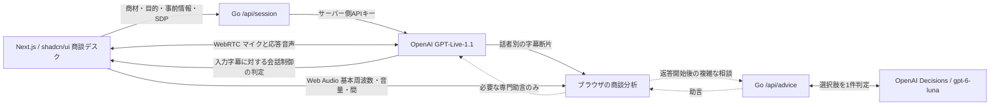

# Sales Artex 商談デスク

商材と商談の目的、相手について分かっていることを入力すると、日本語のAI営業担当がマイク越しに商談を進めます。初期値は架空の見積作成支援サービスです。営業担当者は、顧客の言葉、端末が推定した論点と応答候補、マイクの観測値を同じ画面で確認できます。

## 起動する

Go 1.23以降とNode.js 22.13以降を使います。リポジトリのルートで実行してください。nvmを利用している場合は最初に `nvm use` でNodeを切り替えます。

```sh
npm --prefix frontend ci
npm --prefix frontend run build
go run .
```

[商談デスクを開く](http://127.0.0.1:8787)。ポートを変更する場合は `PORT=8788 go run .` で起動します。GoがNext.jsの静的ビルドとAPIを同じポートから配信します。画面を変更した後はフロントを再ビルドしてください。

### まずテキストで試す

「テキストで試す」を押し、顧客役の発言を入力します。端末内のルールで応答例を組み立てるため、APIキーもマイクも不要です。次の流れでは事前情報、顧客の希望、商談の進捗の違いを確認できます。

| 画面で入力・操作する内容 | 観察する点 |
|---|---|
| 商材を「見積作成支援」、目的を「デモの日程を相談」、事前情報を「設備工事会社の営業責任者。表計算への転記に課題があるかもしれない」に設定 | AIが商材に関連する話題を挙げ、話を続けてよいか尋ねる |
| 顧客役で「二重入力が負担です」 | どの業務に影響するかを聞く方針に変わる |
| 「他社との違いは何ですか」 | 比較で優先する条件を尋ねる |
| 「デモをお願いします」→「来週火曜日がよいです」 | 面談希望と候補日時を表示し、予約は未確定として扱う |
| 「今回はお断りします」 | 次の案内を止め、お礼を伝える |

自由記述の商材・目的・事前情報は音声モデルに渡します。ローカルデモが識別できる話題や目的はコードに登録した範囲です。

### GPT-Liveで会話する

1. プロジェクト直下の `.env` をエディタで開きます。まだファイルがない場合は、同じ場所にある `.env.example` を `.env` という名前でコピーしてください。
2. `OPENAI_API_KEY=` の右側に、GPT-Liveを利用できるOpenAIプロジェクトのAPIキーを貼り付けて保存します。
3. 商談デスクを再読み込みし、「APIキー設定済み」と表示されることを確認します。サーバーが停止中の場合は、プロジェクト直下で `go run .` を実行してください。

シェルで同名の環境変数を設定している場合は、その値が優先されます。`PORT` を変更したときはGoサーバーを再起動し、新しいポートで商談デスクを開いてください。

[音声用の商談デスクを開く](http://127.0.0.1:8787)。商談相手の了解を得て「音声で商談を開始」を押し、マイクを許可します。相手がマイクに話すと、AIの声がスピーカーから返ります。ヘッドセットを使うと回り込みを抑えられます。

- 挨拶に答えても「顧客」の字幕が出ないときは、「使用するマイク」の入力レベルを見ながら話してください。反応がなければ、そのまま内蔵マイクやヘッドセットのマイクを選び直せます。通話とそれまでの会話は続きます。入力音を検出していて字幕が届いていないときは、その状態を同じ欄に表示します。開始前は「マイクを確認（6秒）」で端末内の入力を確かめられます。
- **AIから挨拶を始める**を有効にすると、AI担当が先に名乗り、話を続けてよいか尋ねます。相手が先に話し始めた場合はその発言を優先します。
- **話の途中でも質問できます。** 挨拶中に「ちょっと待ってください。料金だけ教えてください」と話すと、マイクの音を解析できるブラウザでは字幕を待たずにAIの声を抑えます。音響解析が使えない場合は双方の字幕の重なりで判断します。声が続いたら前の説明と専門分析を中断します。相手が言い終え、前の説明が静まった後に新しい返答が届けば、その冒頭から再生します。
- 「少し黙って聞いて」と伝えるとマイクを開いたままAIの再生を止めます。新しい質問や再開の依頼で会話に戻ります。待機中は画面の「会話を再開」も使えます。通話全体を明確に終了する依頼を認識すると、接続を閉じます。
- 「AIから挨拶を始める」のチェックを外すと、相手の声で推論を開始します。このモードでは入出力の字幕が15秒途切れると待機に入ります。
- 「終了」で最終利用秒数とマイクの解放を確認できます。ブラウザは開始から15分で終了をリクエストします。タブの休止や通信断をまたぐ厳密な請求上限は提供しません。
- 追加推論を使う場合は、`.env` に `SALES_EXPERT_MODEL=gpt-6-luna` を設定し、商談デスクを再読み込みします。GPT-Liveは先に直接返答します。複雑な比較では返答の字幕が始まった後に、GoがDecisions APIに次の方針を問い合わせます。追加分析が遅くても音声は続きます。空欄ならこの専門分析を省きます。会話の一時停止・再開・終了を判別する入力字幕のDecisionsトリガーは、どちらの設定でも使います。

## 構成



Goを選んだ理由は、公開APIキーを扱う処理が小さく、標準ライブラリだけでタイムアウトとキャンセルを扱えるためです。音声フレームはGoを経由しません。画面はNext.js App Router、React、shadcn/ui。音声入出力の待ち時間にはWebRTC経路、モデルの発話開始、端末の再生が影響します。「直近の応答待ち時間」には、顧客の発話終了からAIの声をブラウザで再生できるまでの推定秒数を表示します。割り込みで消音した時間も含み、手動で再生を止めた区間は計測から外します。相づちが入ることがあり、内容のある回答までの時間は字幕と合わせて確認します。

| 機能 | 初版の動作 |
|---|---|
| 声の高さ・音量 | 端末でYINに基づく基本周波数（65〜550Hz）とデジタル音量を推定。直近5秒の中央値・音量・観測率を表示。無声や欠測は「—」 |
| テンポ・間 | 200ms以上の内部休止、発音区間数/分、有声音の長さを算出。マイクゲインや雑音の影響を受ける。区間数は単語数・モーラ数とは別の量 |
| 商談の評価 | 発言を根拠に論点、意向、比較条件、目標の進捗を更新。事前情報は仮説として扱い、訂正に追随。音響値は話す間の参考に使う |
| 内なる独白 | 端末のルールで生成した質問候補は画面に表示。複雑な相談で専門モデルの助言が必要な場合だけ短いメモを送信。同一内容を重ねず、受領をイベントIDで照合。自然な発話に反映されたかは別途評価する |
| タイミング | 音声モデルは全二重で会話を継続。字幕断片を約650msまとめて分析し、継続する発話は約2.5秒ごとにも評価。Liveに発話確定イベントがないため、遅れて到着した断片や訂正で見立てが変わる |
| データ | アプリ側の音響履歴は最大2分の数値。商談設定と字幕はページのメモリ上で扱い、DBへの保存や通話録音は行わない。Liveは `store:false` で作成。音声通話時は商談設定・音声をOpenAIへ送信。専門分析が動く場合は商談設定と直近の会話（最大6区間・3,000文字）もGo経由でOpenAIへ送る |
| 目的の達成 | 面談の希望、資料・見積もりの依頼、申込希望は本人の発言で判断する。会話で受けた希望を表示。署名・送付・予約・担当者への自動連絡は未実装。ブラウザ内での対話を実装しており、電話回線は接続していない |

音響計測は顧客側のマイクに対する推定です。複数人を同じマイクで収録した場合は声が混ざります。合成音での検証と実環境での精度は分けて評価します。[YINの原論文](https://doi.org/10.1121/1.1458024)・[Liveのセッション管理](https://developers.openai.com/api/docs/guides/live-conversations)

### Goの変更箇所

| 変更したい内容 | ファイル・パッケージ |
| --- | --- |
| 起動ポート、待ち受け、HTTPサーバーのタイムアウト | [main.go](main.go) |
| 環境変数と `.env` の読み込み | [internal/config](internal/config) |
| ブラウザ向けAPIのルート、入力検証、公開するレスポンス | [internal/desk](internal/desk) |
| OpenAIへの接続、Liveセッションの構成、専門分析のモデル切り替え | [internal/openai](internal/openai) |
| 営業担当の指示、挨拶、会話制御の判定基準 | [instructions.go](internal/openai/instructions.go) |

## 調査と費用

- [ARTEXのアーキテクチャ調査](docs/artex.md)に、REAで解析した箇所、上流コミットへの固定リンク、商談設計に応用した仕組みとライセンスを記載しました。
- [音声API・費用・評価設計](docs/realtime.md)に、Liveと専門分析の単価、月100件・1,000件の試算、待機と終了の使い分け、録音を使った精度・遅延の検証案をまとめました。

## テスト

```sh
go test ./...
go vet ./...
npm --prefix frontend test
npm --prefix frontend run typecheck
```

Goテストはローカルの模擬APIでセッション生成、キーの取り扱い、失敗時の挙動を検証します。ブラウザ側の単体テストは合成波形、字幕の順序、意向の撤回、商談目標と応答手法の対応を検証します。

実際のDecisionsに日本語の意味判定を問い合わせる回帰試験は、`SALES_RUN_SEMANTIC_EVAL=1 go test -run TestLiveConversationMeanings -count=1 -v ./internal/openai` で実行できます。設定したAPIキーを使用する有料の試験です。
